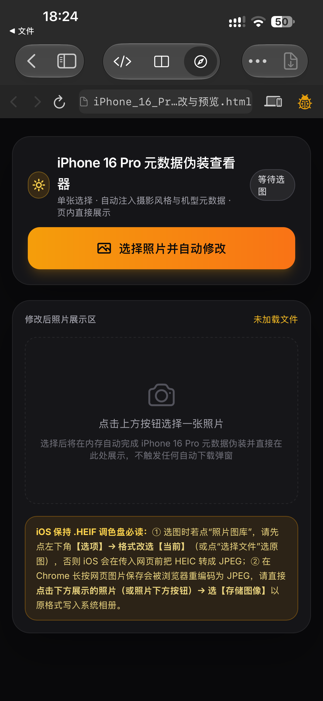
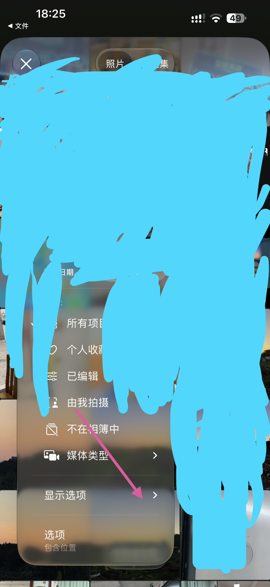
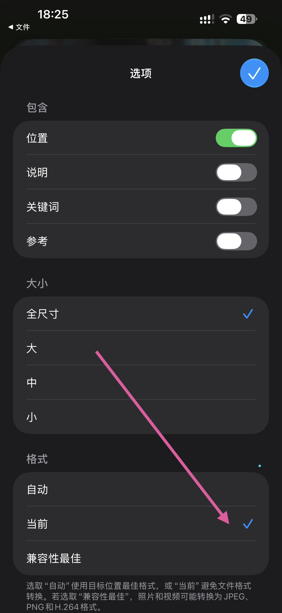
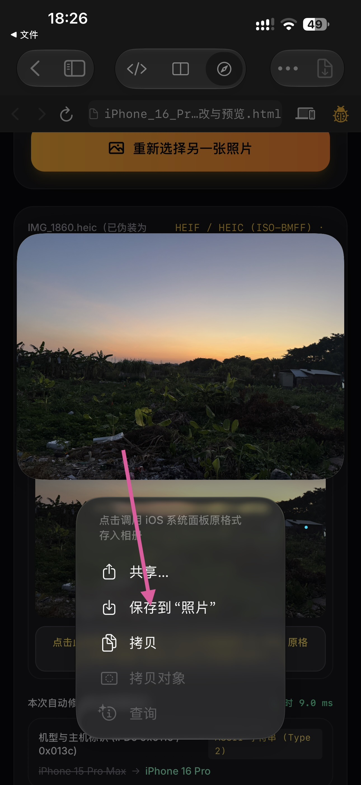
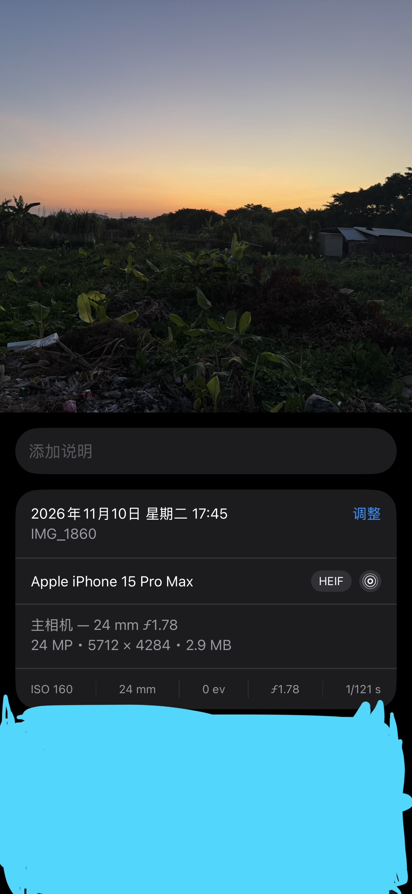
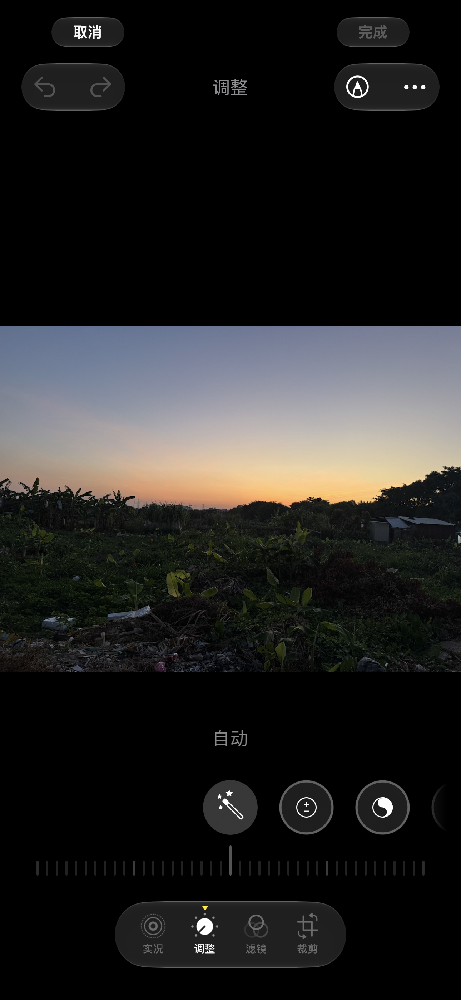
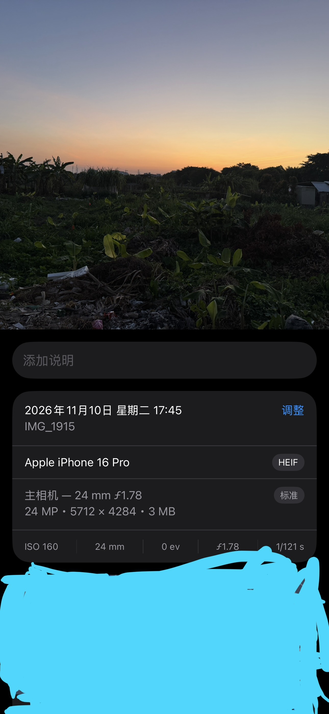
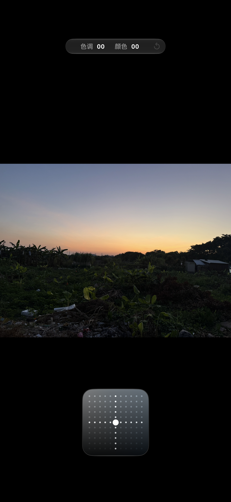

# iPhone 16 Pro 新一代摄影风格（调色盘）解锁工具

**单文件纯前端本地工具 · 无损将 iPhone 15 Pro Max 等旧机型拍摄的 `.HEIC / .HEIF` 照片伪装为 iPhone 16 Pro 拍摄，在 iOS 原生“相册”App 中解锁独占的新一代“摄影风格 2D 调色盘（色调 / 颜色）”。**

> **开源许可声明（Personal & Non-Commercial Use Only）**：本项目遵循 **个人非商业使用许可协议（详见 [`LICENSE`](./LICENSE)）**，**仅限个人学习、研究与非商业使用，严禁任何形式的商业使用、收费代改、二次打包售卖或集成至商业软件中**。

## 一、项目能实现什么与具体效果

1. **解锁 iPhone 16 系列独占的新一代“摄影风格调色盘”**：
   - iPhone 15 Pro Max 等旧款机型直接拍摄的 `.HEIC` 照片，在 iOS 原生“相册”点击“编辑”时仅显示传统滑块（曝光、鲜明度、高光等），无法使用 iPhone 16 系列专属的二维矩阵“调色盘（色调 / 颜色）”与新一代摄影风格预设（如琥珀色、金色、玫瑰金色、静谧、空灵等）。
   - 通过本工具（[`修改.html`](./修改.html) / [`修改程序.html`](./修改程序.html)）在 iOS 浏览器本地处理后，照片在 iOS 原生“相册”中会被完整识别为 **Apple iPhone 16 Pro** 拍摄的摄影风格照片，点击“编辑”即可直接呼出 **新一代 2D 调色盘（色调 / 颜色）**。
2. **100% 原画质无损与非机型元数据完整保留**：
   - **不重编码主图与 HDR 增益图**：直接复用原图 `mdat` 媒体数据盒中的全部主图 HEVC (`hvc1`) 切片流（完整支持 12MP `4032×3024` 与 24MP `5712×4284`）以及原图自带的 Apple HDR 增益图（`tmap` / `hdrgainmap`），画质与动态范围零损失。
   - **保留个人拍摄记忆参数**：拍摄时间（`DateTimeOriginal`）、亚秒精度、快门速度、光圈值（`FNumber`）、感光度（`ISO`）、焦距以及 GPS 经纬度坐标（`GPSInfo`）均原封不动保留。
3. **100% 纯本地离线运行，零隐私泄露**：
   - 整个程序仅为一个独立的 `.html` 文件，所有字节解析与容器重组均在手机浏览器本地内存（`ArrayBuffer` / `Uint8Array`）中瞬间完成（耗时约 `10 ms`），不发起任何网络上传请求，不收集任何个人数据。

## 二、核心实现原理与修改的数据类型全过程

iOS“相册”App 判断一张照片是否支持开启新一代摄影风格调色盘，并非只看表面的 EXIF 机型字符串，而是同时校验 **HEIF (ISO-BMFF) 容器层、TIFF/EXIF 元数据层、Apple MakerNote 私有属性层以及 3 条摄影风格专用辅助数据流**。本工具在浏览器内存中按以下 5 个步骤完成字节级重构：

| 修改层级 | 字段 / 数据盒标识 | 底层数据类型 | 修改前（以 iPhone 15 Pro Max 为例） | 修改后（伪装为 iPhone 16 Pro） | 作用说明 |
| :--- | :--- | :--- | :--- | :--- | :--- |
| **1. ISO-BMFF 容器头** | `ftyp` (File Type Box) | FourCC 品牌标识数组 (`uint32` + ASCII) | `heic`, `mif1`, `MiHE`, `Miaf` | 新增 `MiHB`, `MiHA`, `MiPr`, `tmap` 兼容品牌（52 字节） | 声明该 HEIF 容器支持 Apple 高比特率/Pro 级图像管线与色调映射 |
| **2. TIFF / EXIF 相机与镜头信息** | `IFD0` `0x0110` (`Model`) `IFD0` `0x013c` (`HostComputer`) `ExifIFD` `0xa434` (`LensModel`) | TIFF Type `2` (`ASCII` 空字符结尾字符串) | `iPhone 15 Pro Max` `iPhone 15 Pro Max back triple camera 6.765mm f/1.78` | `iPhone 16 Pro` `iPhone 16 Pro back triple camera 6.765mm f/1.78` | 让 iOS 相册详情面板与编辑管线识别为 iPhone 16 Pro 主摄拍摄 |
| **3. Apple MakerNote 传感器与智能风格标签** | `0x001a` (传感器代号) `0x0001` / `0x0052` / `0x0058` / `0x0060` `0x0054` & `0x005a` (SmartStyle) | Type `2` (`ASCII`) Type `9` (`SLONG` `int32`) Type `7` (`UNDEFINED` 嵌套 `bplist00`) | 传感器代号 `q311n`；含旧版 `0x0040` 标记，缺失 `0x0054` / `0x005a` | 传感器代号改为 `q750n`；移除 `0x0040`，注入 `0x0054`（109B `bplist00`）与 `0x005a`（88B `bplist00`） | 激活 iOS 18+ 新一代 SmartStyle 摄影风格参数字典与预设索引 |
| **4. HEIF 摄影风格核心三件套数据流** | ① `metadata:styles` ② `aux:styledeltamap` ③ `aux:linearthumbnail` | ① `uri ` 项 (`bplist00` 约 57.6KB) ② 48 切片 10-bit `hvc1` + `grid` (`4096×3072`) ③ `hvc1` 线性缩略图流 | **完全缺失**（导致改完 EXIF 仍只有旧版编辑器的根本原因） | 在 `iinf`/`iref`/`ipco`/`ipma`/`idat`/`iloc` 中注册并注入全部 3 组摄影风格数据流 | 提供调色盘实时渲染必需的 3D LUT 网格、10-bit 风格增量网格与线性缩略图 |
| **5. 个人非机型元数据保留** | `DateTimeOriginal`、`SubsecTime`、`FNumber`、`ExposureTime`、`ISOSpeedRatings`、`GPSInfo` (`0x8825`) | `ASCII` / `RATIONAL` (`uint32/uint32`) / `SHORT` | 原始拍摄时间、光圈快门、ISO 与 GPS 经纬度坐标 | **100% 原样无损保留** | 确保相册时间线排序、地点地图与曝光参数完全不变 |

### 关键技术细节（为什么普通改 EXIF 或转成 JPEG 会失效）

1. **为什么 `.JPEG` 格式绝对无法开启调色盘**：Apple 的新一代摄影风格调色盘硬性依赖 ISO-BMFF (`.heif` / `.heic`) 容器中的 `iinf`（项目信息）、`iref`（`auxl`/`dimg`/`cdsc` 引用关系）、`ipco`/`ipma`（属性关联）以及 `mdat` 中的 3 条辅助流（`tag:apple.com,2023:photo:metadata:styles`、`tag:apple.com,2023:photo:aux:styledeltamap`、`tag:apple.com,2023:photo:aux:linearthumbnail`）。`.JPEG` 格式在容器结构上无法承载这些多轨道 HEIF 辅助流，一旦照片在选图或保存环节被转码成 `.JPEG`，相册就只能回退到旧版普通编辑器。
2. **兼容 24MP (`5712×4284`) 与 12MP (`4032×3024`) 原图**：12MP 照片主图切片为 `512×512`，而 24MP 照片主图切片为 `640×896`（原图 `ipco` 中不含 `512×512` 的 `ispe` 属性）。本程序会自动检测并在 `ipco` 中补齐显式的 `ispe (512×512)` 与 `pixi (10,10,10)` 属性，同时严格遵循 ISO/IEC 23008-12 标准将旋转属性 `irot` 置于 `ipma` 属性列表末尾，并为 48 个 `styledeltamap` 切片分配各自独立的 `mdat` 偏移地址。

## 使用教程：

在 iOS 端（Safari 或 Chrome 浏览器）本地打开本项目中的 [`修改.html`](./修改.html)（或 [`修改程序.html`](./修改程序.html)），按以下 4 步操作即可：

### 使用说明1
打开网页后，点击页面中间的 **“选择照片并自动修改”** 按钮：

### 使用说明2
在弹出的系统选图界面中，如果从“照片图库”选图，请先点击底部/右下角的 **“显示选项 / 选项”**：

### 使用说明3
在“选项”面板底部将 **“格式”由“自动”改为“当前”**（避免 iOS 在照片传入浏览器前自动把 `.HEIC` 转码为 `.JPEG`），然后勾选需要修改的照片完成导入：

### 使用说明4
网页会在约 `10 ms` 内自动完成 `.HEIF` 容器与 `iPhone 16 Pro` 元数据重构并展示预览图。**请直接轻点网页中展示的照片（或点击照片下方的按钮）**，在弹出的 iOS 原生菜单中点击 **“保存到‘照片’ / 存储图像”**，即可将未转码的 `.HEIF` 原格式直接写入系统相册（切勿长按网页图片保存，否则浏览器内核会将其重编码为 `.JPEG`）：

## 修改前：

### 修改前1.JPEG
修改前在 iOS 相册上滑查看详情，显示机型为 **Apple iPhone 15 Pro Max**（无摄影风格标记）：

### 修改前2.PNG
修改前在 iOS 相册点击“编辑”，仅有传统的底部圆形调整滑块，**没有新一代摄影风格调色盘**：

## 修改后：

### 修改后1.JPEG
使用本工具修改并存入相册后，上滑查看详情显示为 **Apple iPhone 16 Pro**，右侧出现 **“标准”摄影风格标记**，且 24 MP 分辨率、光圈快门、时间与位置信息完整保留：

### 修改后2.PNG
在 iOS 相册点击“编辑”，成功开启 iPhone 16 Pro 独占的 **新一代摄影风格二维调色盘（色调 / 颜色）**：

## 三、仓库文件说明

- [`修改.html`](./修改.html) / [`修改程序.html`](./修改程序.html)：单文件纯前端修改器主程序（可在 iOS 本地或任意静态网页直接打开使用）。
- `使用说明1.PNG` ~ `使用说明4.jpeg`：iOS 端完整操作步骤图解。
- `修改前1.JPEG`、`修改前2.PNG`：修改前相册参数面板与旧版编辑界面对比图。
- `修改后1.JPEG`、`修改后2.PNG`：修改后相册参数面板与成功开启的新一代调色盘界面对比图。
- [`LICENSE`](./LICENSE)：个人非商业使用开源许可协议（严禁商用）。

## 四、致谢与开源引用（Acknowledgments）

本项目在研究 Apple iOS 18+ 新一代摄影风格（Photographic Styles）HEIF 容器结构与辅助流格式时，参考并受益于以下优秀开源项目与技术资料，特此致谢：

1. **[nathanatgit/Shalielie](https://github.com/nathanatgit/Shalielie)**（[Web 端说明文档](https://github.com/nathanatgit/Shalielie/blob/master/web/README.md) / [Unlicense 协议](https://github.com/nathanatgit/Shalielie/blob/master/LICENSE)）：提供了关于 Apple HEIF 容器中 `tag:apple.com,2023:photo:metadata:styles` (`uri `)、`tag:apple.com,2023:photo:aux:styledeltamap` (`grid`)、`tag:apple.com,2023:photo:aux:linearthumbnail` (`hvc1`) 辅助流结构及 iOS 图库选图/Web Share 保存机制的深入逆向工程研究参考。
2. **[Tailwind CSS](https://tailwindcss.com/)**：用于构建响应式移动端毛玻璃 UI 界面。

## 五、开源许可协议（个人使用 / 禁止商用）

本项目采用 **个人非商业使用许可协议（Personal & Non-Commercial Use License）**：
- **允许**：个人出于非商业目的查看、下载、本地运行、研究及非商业性质的技术交流分享（需保留原项目署名与致谢信息）。
- **严禁商用**：严禁将本项目代码、HTML 页面、内置二进制模板或衍生版本用于任何商业用途（包括但不限于收费代改、付费小程序/App、广告变现工具站、电商平台售卖或企业商业集成）。完整条款请参阅 [`LICENSE`](./LICENSE)。
